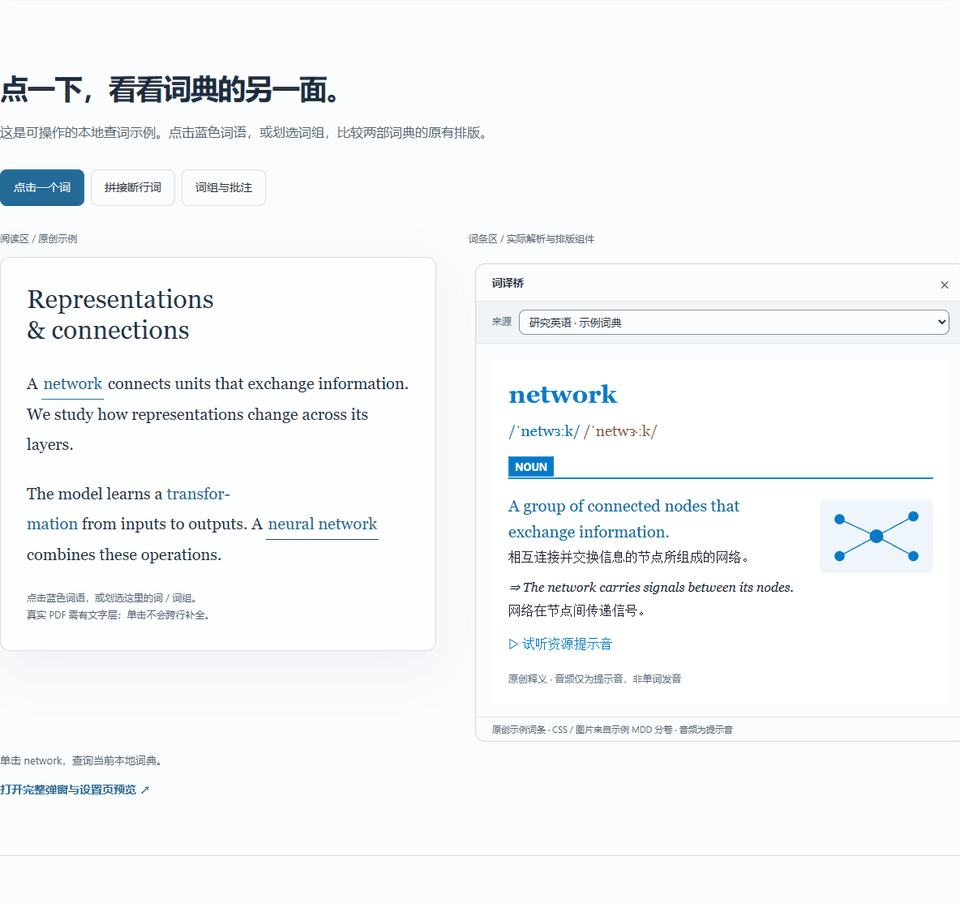
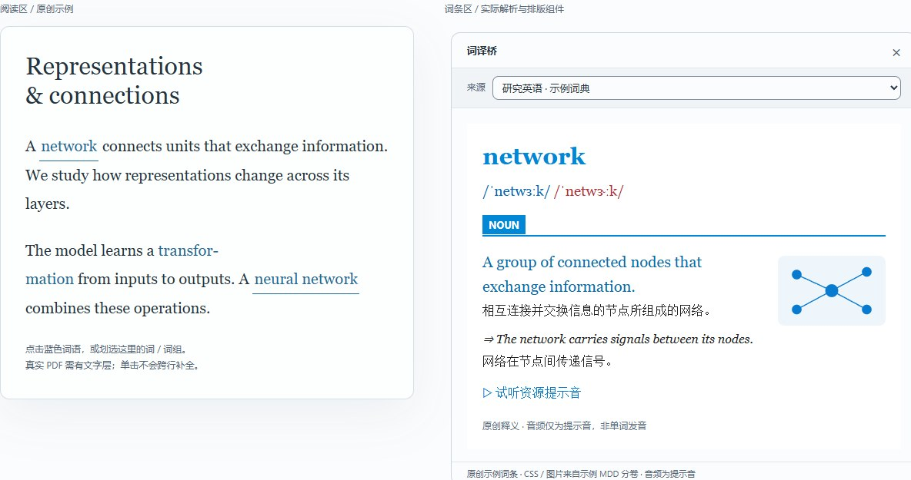

<p align="center"></p>

<h1 align="center">LexiBridge · 词译桥</h1>
<p align="center"><b>Zotero 查词与翻译插件</b><br>本地词典的深度，在线翻译的广度。查词、译句、批注，留在阅读里。</p>
<p align="center">
  <a href="RELEASE_NOTES.md"></a>
  
  <a href="https://github.com/Noahxie83/zotero-lexibridge/actions/workflows/build.yml"></a>
  <a href="LICENSE"></a>
</p>
<p align="center">
  <a href="https://github.com/Noahxie83/zotero-lexibridge/releases"></a>
  <a href="https://noahxie83.github.io/zotero-lexibridge/lexibridge/"></a>
  <a href="docs/USER_GUIDE.md"></a>
</p>

**LexiBridge（词译桥）** 在 Zotero PDF 阅读器中查询 MDX、StarDict、DSL 本地词典，也可按需开启在线翻译。支持覆盖升级，原有词典路径、生词和资源配置继续使用。

## 1.3 系列有什么新变化

- **查词与翻译，共用一组来源。** 加入 Google、Microsoft Edge、有道和 MyMemory，无需填写 API 密钥。在线服务默认关闭，逐项开启。
- **按你的顺序查询。** 本地词典与翻译引擎统一排序；可查当前来源、依次回退，或联合显示多个来源。
- **更快看到首个结果。** 联合查询采用有界并发，先完成的来源先呈现，结果仍按设置顺序排列。
- **点击、划选分别控制。** 可只点击、只划选、同时开启，或关闭两种自动触发后手动输入。
- **弹窗可以拖动。** 拖动标题栏空白处调整位置；历史、切换来源和慢结果更新保持位置。固定与拖动独立。
- **成功结果更干净。** 本地与在线来源成功时不显示诊断区域；未命中、出错或限流时只显示对应来源的诊断。
- **关闭阅读器后仍可继续使用。** 修复失效工具栏节点阻断后续界面更新的问题。

1.3.1 统一项目名称与仓库地址，并精简公开说明。详见 [完整版本变更](docs/CHANGES.md) 与 [升级说明](docs/UPGRADE_1.3.1.md)。

## 看看实际操作

<p align="center"></p>

动图录自网页中的**实际插件解析与排版组件**，使用项目原创词条；不代表真实在线请求或 Zotero 宿主录像。可 [打开交互示例](https://noahxie83.github.io/zotero-lexibridge/lexibridge/) 自己操作，也可 [预览完整弹窗与设置页](https://noahxie83.github.io/zotero-lexibridge/interface-preview.html)。网页批注只演示反馈，音频为提示音，不会写入文献库或调用翻译服务。

<details>
<summary>查看静态图与深色效果</summary>




</details>

## 三种查询方式

| 方式 | 行为 | 适合 |
| --- | --- | --- |
| 当前来源 | 只查当前选中的词典或引擎 | 专注一份释义 |
| 依次回退 | 按启用来源的顺序逐个查询，首个命中后停止 | 先词典，找不到再翻译 |
| 联合查询 | 查询所有启用来源，分来源渐进呈现 | 对照多部词典和译文 |

来源顺序与启用状态在 **设置 → 词译桥 → 查询来源** 中调整。本地联合查询最多并发 2 个任务，在线请求全局最多并发 1 个；这会限制请求数量，不承诺所有引擎同时返回。

## 在线翻译

| 服务 | 用法 | 说明 |
| --- | --- | --- |
| Google 翻译 | 自动识别 → 简体中文 | 实验性接口；可用性与网络、服务限流有关 |
| Microsoft 翻译（Edge） | 自动识别 → 简体中文 | 使用 Microsoft 服务，身份与 Google 独立 |
| 有道网页体验 | 自动识别 → 中文 | 网页体验接口，可能变化或限流 |
| MyMemory | 英语 → 简体中文 | 固定语言方向，受服务配额限制 |

- 所有在线来源**默认关闭**。开启后，查询文本会发送给对应提供方；本地词典内容不随查询上传。
- 查询最多 **256 字符、16 个词**，适合单词、词组和短句，保留原标点；不提供整篇文献翻译。
- 在线结果以纯文本显示，可复制译文。词典发音、浏览词目、生词收藏和笔记等本地能力不会伪装为在线服务能力。
- 超时、错误和限流会明确呈现；限流按引擎冷却，不自动反复重试或偷偷切换提供方。使用“依次回退”时，才按你设置的来源顺序继续。
- 四种服务均有真实 Zotero 成功记录；Google 曾出现限流，后在当时网络环境恢复。一次成功不代表长期可用。[验证范围](docs/UPGRADE_1.3.0.md#验证范围)

## 快速开始

**安装插件。** 从 [GitHub Releases](https://github.com/Noahxie83/zotero-lexibridge/releases) 下载对应版本的 XPI。在 Zotero 中选择 **工具 → 插件 → 齿轮 → 从文件安装插件**，选择安装包。若提示重启，重启 Zotero。本地构建的 1.3.1 成品位于 `dist/lexibridge-1.3.1.xpi`；公开可下载版本以 Releases 为准。

**准备来源。** 打开 **设置 → 词译桥**，添加词典目录或入口文件，开启需要的来源并调整顺序。只用在线翻译时无需添加本地词典。插件不附带商业词典。

**选择查词方式。** 在“查询方式”中分别设置点击与划选开关。打开有文字层的 PDF，点击单词或划选词组。工具栏“查询”或 **Ctrl/⌘+Alt+D** 可手动输入。

**放好弹窗。** 拖动标题栏的空白区域移动；需要保留时点“固定”。使用 × 或 Esc 关闭。成功查询不显示诊断；失败后可展开查看原因。

## 本地能力继续保留

| 能力 | 支持 |
| --- | --- |
| 三种词典格式 | MDX/MDD、StarDict（.ifo）、DSL（.dsl / .dsl.dz） |
| 原有排版与发音 | 本地 HTML/CSS、图片、字体和音频；内置标准 Ogg/SPX Speex 解码 |
| 词组、断行与词形 | 连字符候选、重复词条合并、有限英语词形规则 |
| 阅读记录 | 会话历史、分页词目、拼写建议、手动输入 |
| 生词与笔记 | 收藏词条及可用的文献上下文，主动写入 Zotero 笔记，导出 CSV / Anki TSV |
| 设置与迁移 | 浅色/深色/系统主题、字号尺寸、资源分卷顺序、设置备份与路径迁移 |
| 查词与批注 | 插件划选菜单中的 8 色、高亮、下划线；也可恢复 Zotero 自带菜单 |

## 词典与资源

本地词典需自行准备，可在 [PDAWiki · MDict 专区](https://www.pdawiki.com/forum/forum.php?gid=7) 查找，并按作者授权使用。保留配套资源目录结构。

| 格式 | 选择入口 | 保留的文件 |
| --- | --- | --- |
| MDX | `.mdx` | 同名 `.mdd`、数字分卷及外置资源 |
| StarDict | `.ifo` | `.idx` / `.idx.gz` 与 `.dict` / `.dict.dz`；可选 `.syn` |
| DSL | `.dsl` / `.dsl.dz` | 同目录或 `词典.dsl.files/` 中的资源；ZIP 需先解压 |

[格式支持范围](docs/FORMAT_SUPPORT.md) · [资源支持](docs/RESOURCE_SUPPORT.md) · [Speex 说明](docs/SPEEX_AUDIO.md)

## 常见问题

<details>
<summary>升级会丢失设置吗？</summary>

覆盖升级会保留词典目录、资源配置、生词记录和查询设置。也可以在设置中主动导出备份，再于其他设备导入。

</details>
<details>
<summary>能完全离线使用吗？</summary>

可以。本地词典与本地发音在设备上处理。保持所有在线来源关闭即可。

</details>
<details>
<summary>如何只点击、不划选，或反过来？</summary>

保持总开关开启，分别设置“点击单词后自动查询”与“划选单词或词组后自动查询”。两项均关闭时仍可手动查询。选择 Zotero 自带划选菜单会暂停划选自动查询，点击按自身开关运行。

</details>
<details>
<summary>Google 网页可用，插件为什么仍失败？</summary>

网页和插件使用的请求端点与会话不同。查看失败诊断，区分网络错误与 HTTP 限流。不要连续重试；可关闭该来源，选择其他已启用服务。

</details>
<details>
<summary>词典有释义，却缺少样式、图片或发音？</summary>

确认配套 MDD 和外置资源完整。名称不同的资源包需手动关联；失败诊断可帮助查找缺失资源。词典自带 JavaScript 不执行。

</details>

[完整使用指南](docs/USER_GUIDE.md) · [设置恢复与回退](docs/RESTORE.md) · [发布说明](RELEASE_NOTES.md)

## 兼容范围

支持 **Zotero 10.0 系列**，宿主实测为 Windows Zotero 10.0.6。PDF 需要文字层，扫描件需先 OCR。其他平台和 Zotero 版本、大型真实词典集合与长时间内存表现尚未完成本轮验收。性能测量使用合成小词典，不将其数值作为生产环境承诺。

## 开发与构建

插件运行无需 Node.js 或 Python；开发需要 Node.js。

```sh
npm ci --ignore-scripts
npm test
npm run build
npm run build:site
npm run pack:source
```

安装包、源码快照和离线网页生成于 `dist/`。网页源文件位于 `examples/`，线上展示页为 `docs/lexibridge/index.html`，旧首页保留跳转。品牌、设计与生成素材说明见 [展示页设计](docs/SITE_DESIGN.md)。

## 开源许可

采用 **[GPL-3.0-or-later](LICENSE)**，依赖许可见 [THIRD_PARTY.md](THIRD_PARTY.md)。LexiBridge 是独立 Zotero 插件，非 Zotero 官方产品。词典内容与资源以各自作者授权为准。
